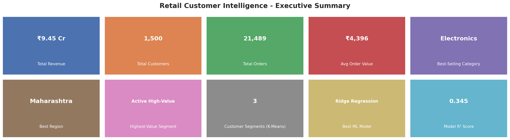
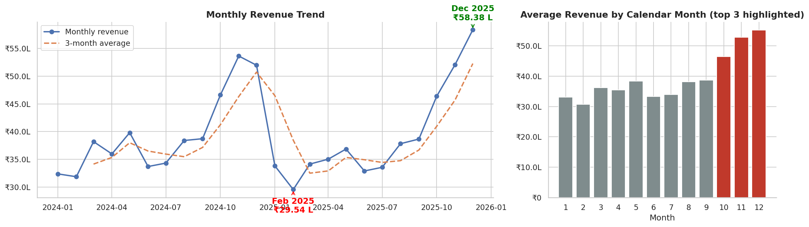
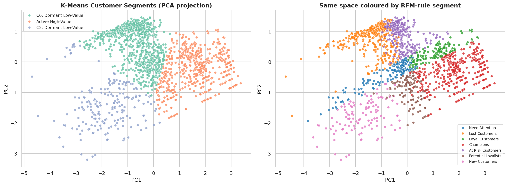
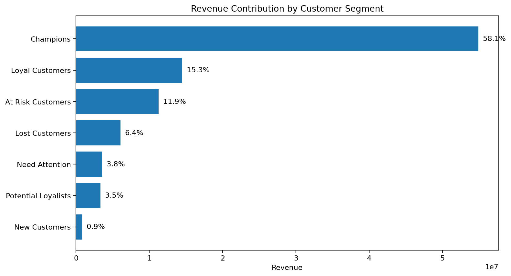
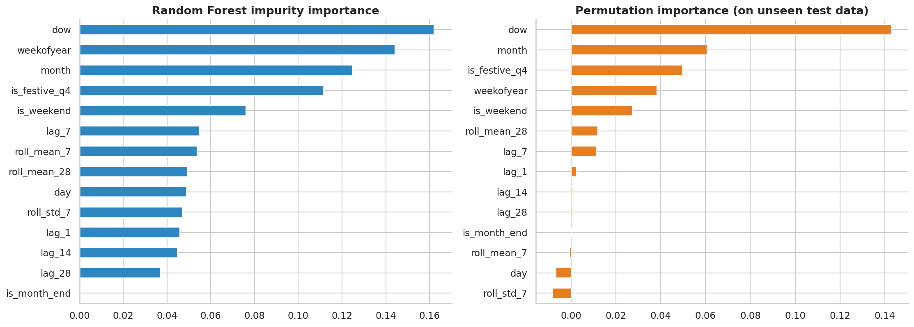
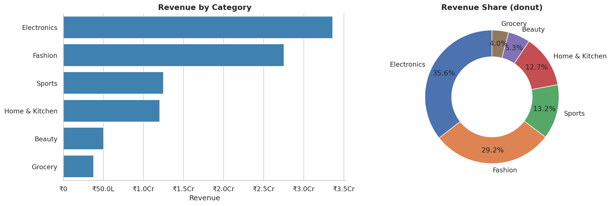

# Retail Customer Intelligence & Sales Prediction

End-to-end Data Science project covering **data cleaning → EDA → RFM analysis → K-Means customer segmentation → PCA → leakage-aware daily revenue forecasting → model comparison → business recommendations**.

## Why this project?

Retail transaction data contains valuable information about products, customers, regions, discounts, and purchasing patterns, but raw transactions do not directly answer business questions. This project converts transaction-level data into customer intelligence and revenue forecasts.

### Business questions answered
- Who are the most valuable customers?
- Which customers are at risk of becoming inactive?
- Which products, categories, and regions drive revenue?
- What purchasing patterns and seasonal trends exist?
- How can customers be segmented using RFM behaviour?
- Can future daily revenue be forecast without target leakage?
- What actions should a retail business take from the results?

## Highlights

- Audit-first data cleaning with explicit row-removal checks
- Feature engineering for revenue, calendar, customer, and sales-history variables
- RFM scoring with seven named behavioural segments
- K-Means clustering on log-transformed and standardized RFM features
- Cluster selection using elbow analysis and silhouette score
- PCA visualization and clustering quality evaluation
- Leakage-aware daily revenue forecasting using lag and rolling features
- Time-based train/test split and `TimeSeriesSplit` hyperparameter tuning
- Comparison of Ridge, Random Forest, HistGradientBoosting, XGBoost, and a naive baseline
- 30-day recursive revenue forecast
- Permutation and tree-based feature importance
- Automatically generated business recommendations and exported results

## Results

The included synthetic dataset contains **54,063 raw transaction records**. On the held-out forecasting period, the current models achieved:

| Model | MAE | RMSE | R² | MAPE |
|---|---:|---:|---:|---:|
| **Ridge Regression** | **₹28,556** | ₹36,387 | 0.345 | **19.5%** |
| **Random Forest (tuned)** | ₹29,139 | **₹36,168** | **0.352** | 19.9% |
| Random Forest (baseline) | ₹30,075 | ₹37,327 | 0.310 | 21.0% |
| XGBoost | ₹31,866 | ₹40,456 | 0.190 | 21.8% |
| Hist Gradient Boosting | ₹33,035 | ₹41,594 | 0.144 | 22.2% |
| Naive baseline | ₹40,552 | ₹49,823 | -0.229 | 27.7% |

Ridge gives the lowest MAE/MAPE, while the tuned Random Forest gives the highest R² and lowest RMSE. The final model choice should therefore be explained using the chosen business evaluation priority rather than model complexity alone.

The RFM analysis also shows strong customer-value concentration: **Champions represent about 24.4% of customers but contribute about 58.1% of revenue** in the included synthetic dataset.

## Key findings

- High-value customers contribute a disproportionately large share of revenue, making retention especially important.
- RFM segmentation separates customers into actionable groups such as Champions, Loyal Customers, At Risk Customers, Lost Customers, and New Customers.
- Sales exhibit temporal and weekday patterns that can be used for forecasting and planning.
- Historical lag/rolling features and calendar features provide useful signals for daily revenue forecasting.
- The ML models outperform the naive same-weekday-last-week baseline on the held-out period.

## Forecasting design decision

The project forecasts **daily revenue rather than transaction-level revenue**. Transaction-level revenue is directly calculated from quantity, unit price, and discount:

`Revenue = Quantity × UnitPrice × (1 − Discount)`

Using those same variables to predict the already-calculated target would make the prediction problem largely tautological. Instead, the project aggregates revenue by day and predicts future daily revenue using historical lag/rolling features and calendar information.

The forecasting pipeline uses a chronological train/test split, shifted rolling features, time-series cross-validation, and recursive future prediction to reduce leakage.

## Visualizations

### Executive summary



### Sales trend



### Customer segmentation



### Revenue contribution by segment



### Feature importance



### Category analysis



## Tech stack

- **Python**
- **Jupyter Notebook**
- **Pandas / NumPy** — data processing
- **Matplotlib / Seaborn** — visualization
- **Scikit-learn** — preprocessing, clustering, PCA, regression, evaluation, tuning
- **XGBoost** — optional gradient-boosting comparison

## Project structure

```text
Retail-Customer-Intelligence/
├── Retail_Customer_Intelligence.ipynb
├── README.md
├── requirements.txt
├── data/
│   ├── README.md
│   └── synthetic_retail.csv
├── images/
│   ├── category_analysis.png
│   ├── customer_segments.png
│   ├── dashboard_summary.png
│   ├── feature_importance.png
│   ├── sales_trend.png
│   └── segment_revenue_contribution.png
└── outputs/
    ├── customer_segments.csv
    ├── forecast_next_days.csv
    ├── model_comparison.csv
    └── rfm_segment_summary.csv
```

## Quick start

```bash
pip install -r requirements.txt
jupyter notebook Retail_Customer_Intelligence.ipynb
```

Run the notebook from top to bottom. The included synthetic dataset is used by default.

## Using real data

Place a CSV at `data/retail_dataset.csv`. The notebook maps common column-name aliases. The core required fields are:

- Invoice/order ID
- Customer ID
- Quantity
- Unit price
- Date

Optional fields include product ID/name, category, region/country, and discount. If optional fields are absent, the notebook applies documented defaults/derivations where appropriate.

Raw third-party datasets should not be committed unless their license permits redistribution.

## Outputs

The notebook exports:

- `outputs/customer_segments.csv` — customer-level RFM and cluster information
- `outputs/rfm_segment_summary.csv` — segment-level customer and revenue statistics
- `outputs/model_comparison.csv` — forecasting model metrics
- `outputs/forecast_next_days.csv` — 30-day recursive revenue forecast
- `images/` — presentation-ready charts

## Limitations and future work

- RFM segments are behavioural snapshots and should be refreshed periodically.
- The forecast currently uses transaction history and calendar features; promotions, holidays, pricing, marketing spend, and external factors could improve accuracy.
- Product-level and region-level forecasting could support more detailed inventory planning.
- With real data, returns, partial periods, bulk/B2B orders, and unusual outliers should be investigated according to the business context.

## Project outcome

This project demonstrates an end-to-end Data Science workflow that combines **analytics, customer intelligence, unsupervised learning, supervised forecasting, model evaluation, and business decision-making** rather than treating Machine Learning as an isolated modeling step.
